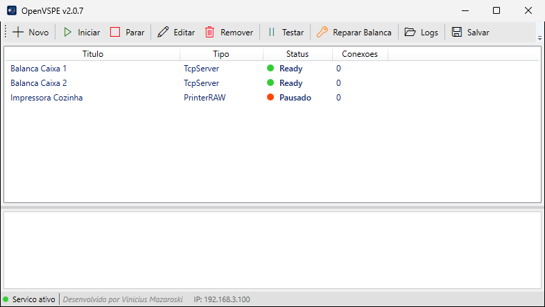

# OpenVSPE

Sistema de ponte Serial/TCP para balanças (Toledo Prix III) e impressoras térmicas, desenvolvido em .NET 8.

Criado como alternativa ao VSPE (Virtual Serial Ports Emulator), que exige conta e não inicia junto com o Windows: o OpenVSPE roda como serviço do Windows e sobe automaticamente, sem login. Projeto independente, sem vínculo com a Eterlogic.



## ⬇️ Download
Baixe o `.zip` da versão mais recente em [Releases](https://github.com/VMazza10/OpenVSPE/releases/latest), extraia e execute `OpenVSPE_V*.exe` como administrador.

## 🚀 Funcionalidades
- Emulação de porta serial via TCP.
- Suporte a múltiplas balanças e impressoras.
- Interface moderna ao estilo VSPE.
- Mecanismo de recuperação de hardware integrado.
- Instalador automatizado com verificação de runtime.

## 📁 Estrutura do Repositório

| Pasta | Descrição |
| :--- | :--- |
| **[/src](src)** | Código-fonte da solução C#. |
| **[/scripts](scripts)** | Scripts PowerShell de build, instalação e teste. |
| **[/docs](docs)** | Manual do usuário. |

Projetos em `src/`:

| Projeto | Função |
| :--- | :--- |
| `OpenVSPE.Core` | Modelos, configuração (`channels.json`) e logs. |
| `OpenVSPE.Serial` | Canais de porta serial. |
| `OpenVSPE.Printing` | Canais de impressora térmica. |
| `OpenVSPE.Service` | Serviço do Windows que gerencia os canais. |
| `OpenVSPE.UI` | Interface WPF para configurar os canais. |
| `OpenVSPE.Setup` | Instalador. |

## 🛠️ Como Compilar e Rodar

### 1. Requisitos
- .NET 8.0 SDK (Desktop Runtime).
- Usuário com permissões de administrador (para instalação do serviço).

### 2. Compilação Completa
Para compilar todos os projetos e gerar o pacote de instalação, utilize o script de build:
```powershell
cd scripts
.\build.ps1
```
Os arquivos de saída estarão localizados em `/build/releases/DEPLOY`.

### 3. Scripts Úteis
- `build.ps1`: Automatiza a limpeza, publicação e empacotamento.
- `Instalar.ps1`: Script auxiliar para configuração de ambiente.
- `install-service.ps1` / `uninstall-service.ps1`: Instala ou remove o serviço do Windows.
- `test-balanca.ps1`, `test-print.ps1`, `test-tcp.ps1`: Testes manuais de balança, impressora e conexão TCP.

## 📝 Observações Importantes
- O sistema é focado na arquitetura **x86** para garantir compatibilidade total com drivers de balanças e portas seriais virtuais.
- A solução principal é `OpenVSPE.sln`, que inclui todos os módulos, incluindo o Instalador.

## 📄 Licença
Distribuído sob a licença MIT. Veja [LICENSE](LICENSE).

---
**Desenvolvido por Vinicius Mazaroski**
